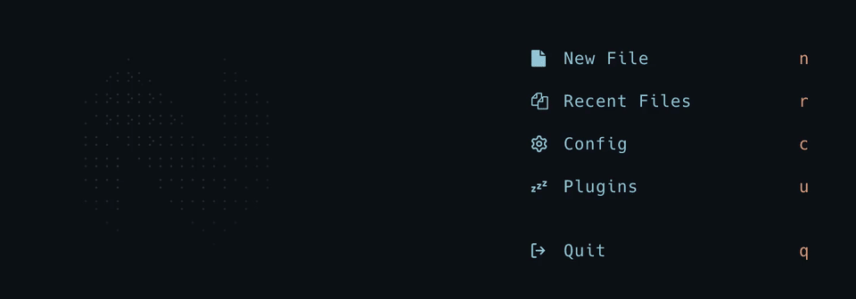

# fadein.nvim

An animated neovim logo that makes your startup dashboard stylish but not
distracting.



Requires Neovim 0.10+ and [snacks.nvim](https://github.com/folke/snacks.nvim).

## Install

With [lazy.nvim](https://github.com/folke/lazy.nvim):

```lua
{
  "folke/snacks.nvim",
  lazy = false,
  priority = 1000,
  dependencies = { "CruelAddict/fadein.nvim" },
  opts = function()
    return {
      dashboard = {
        enabled = true,
        sections = {
          -- instead of "header" section
          require("fadein").section({ animation = "n" }),
          { section = "keys", padding = 1 },
          { section = "startup" },
        },
      },
    }
  end,
}
```

